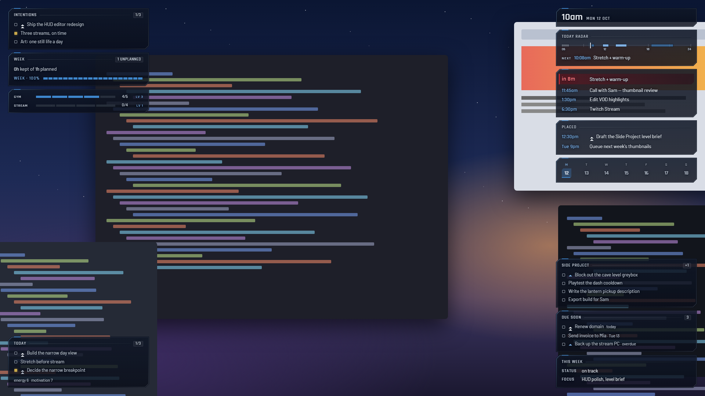

# Desktop HUD

Your next event and this week's priorities, at a glance, on your Windows desktop.

Desktop HUD puts small see-through "bubbles" in the corners of your screen: the
time, what's next on your calendar, and, if you keep notes, what matters this week.
Clicks pass straight through them to whatever is underneath. When you step away, a
calm idle screen fades in. It works over any wallpaper.



> **Status: v0.9 Preview.** Free and open source (MIT). Windows 10 (22H2) and 11, x64.

## What it does

- **Calendars.** Paste a private calendar link (Google, Outlook, Apple iCloud, a
  university timetable) or add an .ics file. Add as many as you like. Next up
  shows what's coming and counts down to the next block.
- **Notes, if you want them.** Use its built-in notes, or point it at a folder of
  Markdown notes (an Obsidian vault works). It shows this week's intentions and
  tasks, a daily note, or any section of any note. Your folder stays
  **read-only** unless you turn writing on.
- **Bubbles you arrange.** Choose from presets (Minimal, Focus, Full), drag
  bubbles between corners, and make your own from a note section, a task query or
  a few words of text. Hide any corner from screen capture.
- **Quiet by design.** No hotkeys until you pick them. It's click-through, and
  always one tray click from hidden. It uses almost no CPU when idle.

The [user manual](docs/README.md) covers setting up, each feature, and
troubleshooting.

## Install

Download the installer from [Releases](../../releases). It installs for your
user only, with no admin rights needed.

The installer isn't code-signed yet, so Windows SmartScreen may say it "protected
your PC": choose **More info**, then **Run anyway**. Each release lists SHA-256
checksums if you want to check your download.

On first start, a three-step set-up asks about notes, a calendar and your corners.
Every step can be skipped.

## Privacy

- **It reads** your calendar links and files (every 15 minutes), the notes folder
  you choose if any, and what your music app reports to Windows' media controls.
- **It writes** its own settings, a calendar cache and its built-in notes, in your
  Windows profile. In *your* notes folder it writes nothing, unless you turn
  writing on. Then it writes two things only, checks first, and keeps backups.
- **It sends** nothing, except fetching your own calendar links. No account, no
  analytics, no telemetry. Logs stay on your PC.

Calendar links are stored encrypted with Windows' data protection and never shown
again. **Display & HUD → Integrations → Your data** saves a redacted diagnostics
file for bug reports, exports your settings, or removes everything the app keeps.
See [Uninstalling and your data](docs/uninstall.md).

## Support

Desktop HUD is a hobby project, maintained in spare time:

- **Best effort, no guaranteed response time.** Issues are looked at about once a
  month.
- **Windows 10 (22H2) and 11, x64 only.** ARM64, macOS and Linux aren't supported.
- **Bugs:** open an issue using the template, and attach the diagnostics file
  (**Integrations → Your data → Save diagnostics…**).
- **Ideas and questions:** use Discussions.
- **Security problems:** report them privately; see [SECURITY.md](SECURITY.md).

## Build from source

You need Node.js 24 and Windows. [CONTRIBUTING.md](CONTRIBUTING.md) has the
details.

```bash
npm ci
node node_modules/esbuild/install.js
node node_modules/electron/install.js
npm run app          # run from source, with hot reload
npx vitest run       # unit tests
npm run dist:public  # the installer, as a release builds it
```

## Licence

[MIT](LICENSE). Desktop HUD includes third-party software under its own licences:
see [THIRD_PARTY_NOTICES.md](THIRD_PARTY_NOTICES.md).
